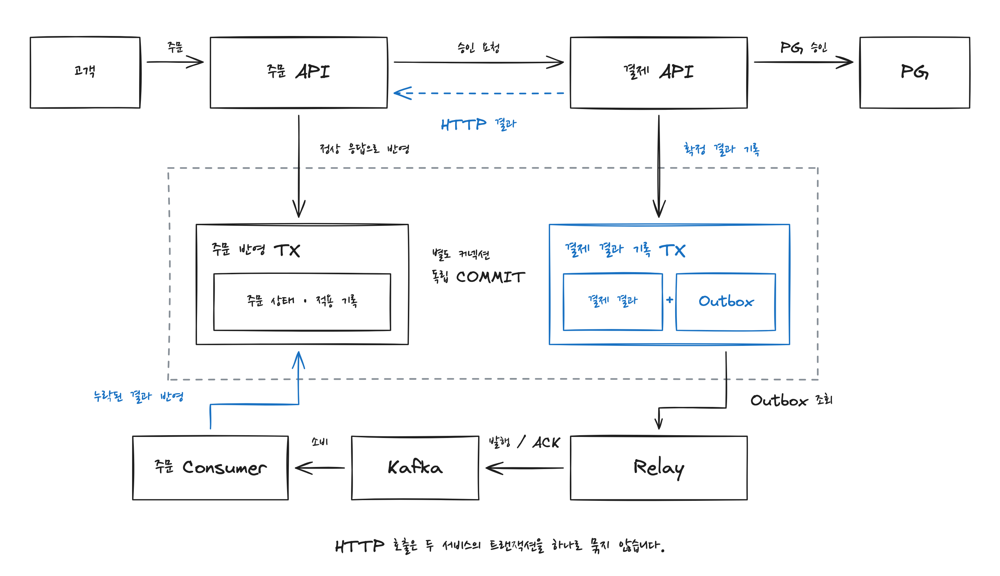
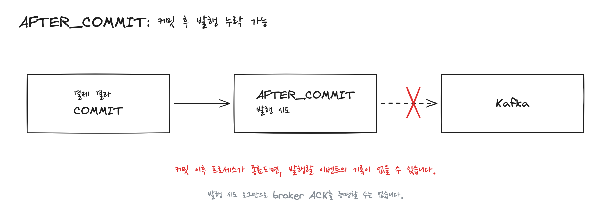
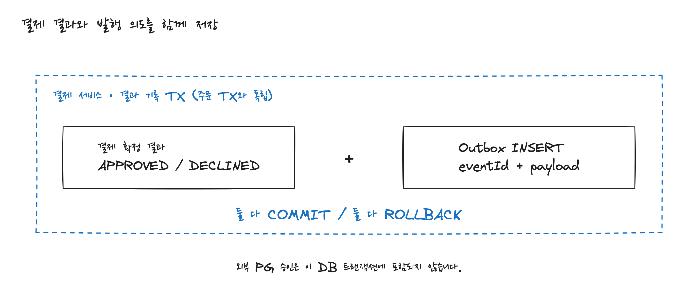
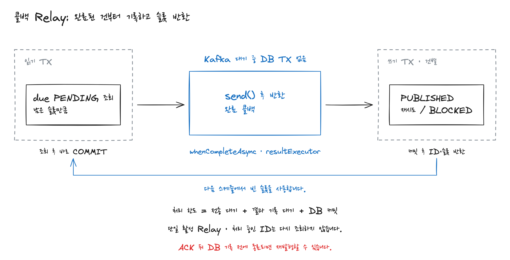
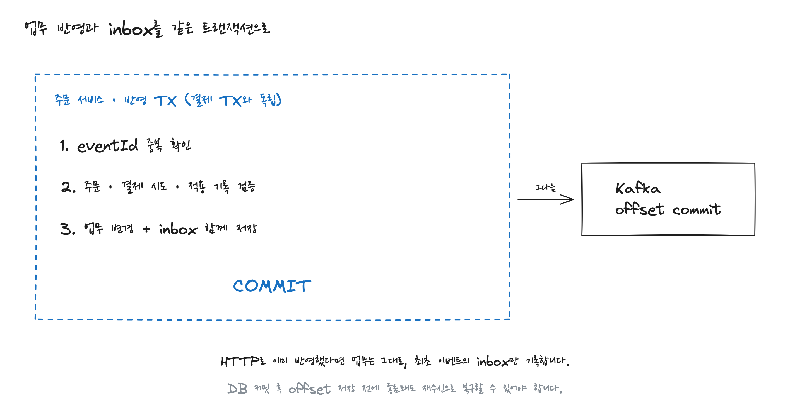
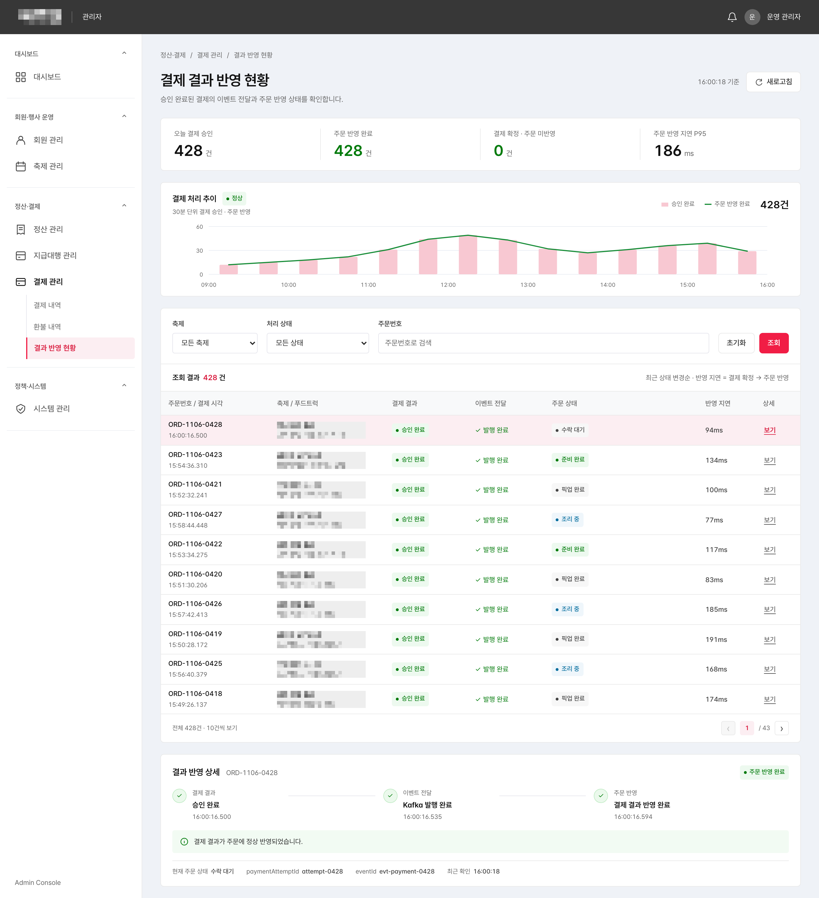
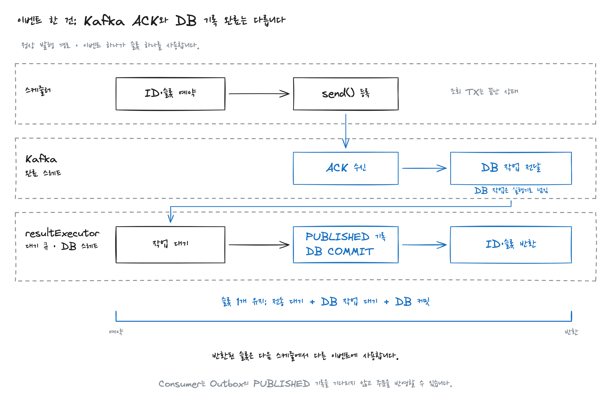
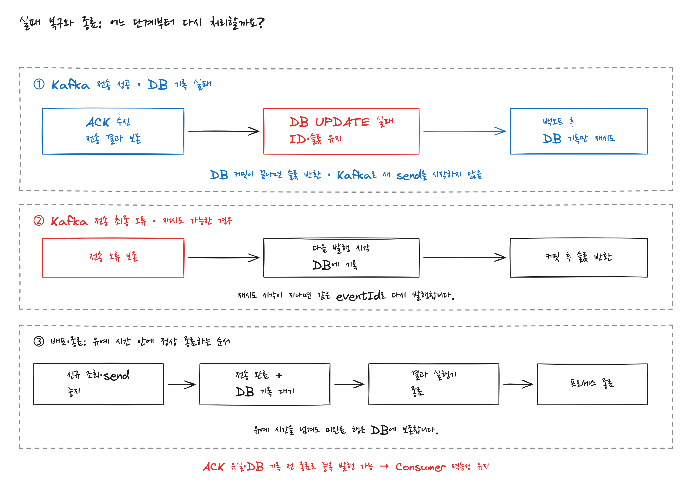

# 결제는 됐는데 판매자에게 주문이 보이지 않았다: Transactional Outbox와 Relay 개선

> 손님은 결제했다는데, 들어온 주문이 없어요.

결제 서비스에는 승인 성공 결과가 남아 있었지만 주문은 **결제 대기**였습니다. 판매자는 주문을 확인할 수 없었고, 고객에게 다시 결제하도록 안내하기도 어려웠습니다. 이미 승인된 결제를 한 번 더 만들 수 있기 때문입니다.

필요한 것은 승인 API를 다시 호출하는 일이 아니었습니다. **이미 확정된 결제 결과를 잃지 않고 주문에 반영하는 경로**였습니다. 이 글에서는 그 경로에 Outbox를 도입한 이유와, 전달 지연을 줄이면서 콜백 Relay를 선택한 근거를 다룹니다.

## 1. 결제는 됐다는데, 주문은 어디 갔을까

처음에는 판매자 화면의 갱신 문제를 의심했습니다. 그런데 주문 조회 API에서도 해당 주문은 결제 대기였습니다. 화면을 새로고침해서 해결할 일이 아니었습니다.

같은 주문번호로 APM과 요청 로그를 따라갔습니다. 결제 서비스에는 PG 승인 성공과 결제 결과 저장 기록이 있었지만, 주문 서비스에는 그 결과를 반영한 기록이 없었습니다. 여기서 확인한 것은 **결제 결과와 주문 상태가 일치하지 않는다는 사실**입니다. 이것만으로 HTTP 응답 유실인지, 이벤트 발행이나 적용 실패인지까지 확정할 수는 없었습니다.

여러 축제의 여러 푸드트럭이 플랫폼을 사용하고 고객은 QR로 메뉴를 열어 주문합니다. 주문 서비스와 결제 서비스는 배포 단위가 분리돼 있습니다. 같은 MySQL 인스턴스를 사용하지만 각자 소유한 테이블과 독립적인 트랜잭션을 관리합니다. 결제 서비스는 승인과 취소, 환불뿐 아니라 판매자별 정산과 지급대행도 담당합니다. 운영의 Kafka 브로커는 Amazon MSK를 사용합니다.



정상 경로는 주문 서비스 → 결제 서비스 → PG의 동기 HTTP 호출입니다. 결제 결과가 돌아오면 주문 서비스가 자기 TX에서 **결제 확인 후 판매자 수락 대기**를 기록합니다. 이후 판매자가 수락하면 조리 중으로 넘어갑니다.

결제 커밋 뒤 HTTP 응답을 놓치거나, 응답을 받은 주문 서비스가 DB에 기록하기 전에 종료되면 결제만 성공한 상태가 남을 수 있습니다. 같은 MySQL을 사용해도 두 서비스의 처리가 하나의 로컬 TX에 포함되지는 않습니다. 따라서 타임아웃을 승인 실패로 바꾸지 않고 기존 `paymentAttemptId`의 결과부터 확인해야 했습니다.

## 2. 전달할 결제 결과를 DB에 남겼다

기존에는 `@TransactionalEventListener(AFTER_COMMIT)`에서 Kafka로 이벤트를 보냈습니다. DB 커밋이 끝난 뒤 실행되므로 롤백된 결과를 발행할 위험은 줄지만, **DB 커밋과 Kafka 기록을 원자적으로 완료하는 것은 아닙니다.** [Spring의 트랜잭션 이벤트 실행 시점](https://docs.spring.io/spring-framework/reference/data-access/transaction/event.html)



커밋 후 리스너 실행 전이나, 비동기 send 등록 후 브로커 기록 전에 프로세스가 종료되면 재시작 후 발행 대상을 식별할 기록이 없을 수 있습니다. `.get()`으로 ACK를 기다려도 이미 끝난 DB 커밋과 Kafka 전송이 하나의 원자적 작업으로 처리되지는 않습니다. 반대로 커밋 전에 보내면 이벤트만 전달된 뒤 DB가 롤백될 수 있습니다.

그래서 **승인 결과와 발행할 이벤트를 결제 서비스의 같은 로컬 TX에 저장**하도록 경계를 정했습니다. PG 호출은 이 TX 밖에서 수행하고, 확인된 결과를 전달합니다. 핵심 저장 경계는 다음과 같습니다.

```java
@Transactional
public ConfirmedPaymentResult recordResult(VerifiedPgResult pgResult) {
    var payment = payments.findByAttemptIdForUpdate(
        pgResult.paymentAttemptId());

    var existing = results.findByPgResultKey(pgResult.key());
    if (existing.isPresent()) {
        existing.get().verifySameFact(payment.id(), pgResult);
        return existing.get();
    }

    var result = payment.confirm(pgResult); // 검증과 순번 확정
    results.save(result);
    outbox.save(PendingPaymentEvent.from(result)); // ID와 payload 고정
    return result;
}
```

같은 결제의 결과 반영은 동일한 결제 행을 잠그고, PG 결과 키와 `(payment_id, event_sequence)`에는 유일성 제약을 둡니다. 제약 충돌 시에는 실패한 TX를 롤백하고 새 TX에서 기존 결과를 읽어 같은 원거래와 금액인지 확인합니다. 위 코드는 그 바깥 재조회 경로를 생략했습니다.



이제 결제 결과와 Outbox INSERT가 함께 커밋되거나 함께 롤백됩니다. Relay는 DB에 남은 PENDING을 다시 찾을 수 있습니다. Outbox를 별도 `REQUIRES_NEW`로 저장하거나 AFTER_COMMIT에서 INSERT하면 결제 결과와 Outbox가 같은 TX에서 커밋된다는 보장이 없어집니다. PG 승인 자체와 주문 상태 변경은 이 로컬 TX 밖에 있습니다.

이벤트는 확정 순간의 `eventId`, 원주문과 결제 식별자, 결과 순번과 금액을 담아 저장합니다. Relay가 재발행할 때도 **동일 ID와 payload**를 사용합니다. 발행 시점의 현재 결제를 다시 직렬화하면, 승인 후 환불된 결제를 승인 사건의 내용으로 보내는 문제가 생길 수 있습니다.

결제 서비스 안의 1분 주기 대사는 PG 결과가 미확정인 시도를 확인합니다. Outbox는 이미 확정된 결과를 후속 처리에 전달하는 데 사용합니다. 도입 전에 누락된 이벤트에는 Outbox 행이 없으므로, 당시의 불변 확정 내역과 주문 적용 이력을 대조하는 별도 복구가 필요합니다. Outbox 도입만으로 과거에 누락된 이벤트가 자동 복구되는 것은 아닙니다.

## 3. 지연되어서 좋은 데이터는 없다.

Outbox에 결과를 남겨도 언제 전달될지는 별개의 문제였습니다. 주문이 몰릴 때는 결제 결과와 Outbox가 있는데도 판매자가 주문을 뒤늦게 확인하는 문제가 남았습니다. PG 승인이 늦은 것과 **승인이 끝난 뒤 전달을 기다리는 것**부터 구분했습니다.

기존 Relay는 한 회차 최대 100건을 먼저 send한 뒤 모든 future를 공통 마감까지 수집하고, 결과를 한 번에 기록했습니다. `fixedDelay=5000`이므로 다음 조회는 **회차 처리 시간 + 5초 뒤**였습니다. 처리 시간이 0이어도 회차당 100건이면 초당 20건을 넘기기 어렵습니다. 이는 코드에서 계산한 상한이며 측정한 최대 처리량은 아닙니다. [Spring fixedDelay의 실행 기준](https://docs.spring.io/spring-framework/reference/integration/scheduling.html)

먼저 폴링 주기로 생기는 대기 시간을 줄였습니다. 운영 당시 회고로 HTTP 반영을 놓친 주문의 결제 확정 후 반영 지연은 약 5초에서 약 200ms로 줄었습니다. 이 근사값을 평균이나 p95로 부르지는 않습니다. 아래는 별도로 정의한 구간을 로컬 모델에서 측정한 결과입니다.

비교에서는 운영과 같은 **MySQL Outbox → Kafka → 주문 DB 반영 구조**를 로컬에 구성했습니다. 비교 환경은 MySQL 8.4와 Kafka 4.1.2 단일 브로커이며, 같은 선전송과 일괄 기록 Relay의 fixedDelay만 5초와 100ms로 바꿨습니다. 같은 JVM의 단조 시계로 **결제 커밋 완료 확인 → 주문 DB 커밋 완료 확인**을 기록했습니다. 실제 PG와 판매자 화면 갱신 시간은 포함하지 않았습니다.

| 별도 비교 조건 | 지표 | 5초 | 100ms |
|---|---|---:|---:|
| 200건 중 HTTP 응답을 늦춘 40건을 이벤트로 반영 | 해당 40건의 반영 p95 | 5,241.0ms | 202.1ms |
| 초기 적체 300건 + 신규 400건 지속 유입 | 현재까지 커밋된 결과의 미반영 수가 처음 0이 된 시점 | 35.69초 | 0.68초 |
| 같은 적체 조건 | 신규 400건의 반영 p95 | 20,212.4ms | 146.9ms |

각 수치는 3회 실행별 값의 중앙값입니다. 첫 조건은 모의 PG HTTP와 목표 유입 20건/초, 두 번째는 PG와 HTTP 없이 목표 초당 20건으로 20초 동안 추가한 별도 비교입니다. 두 조건의 상세 수치는 접힌 측정 자료에 남겼습니다.

초기 적체 조건에서 기존 300건의 반영은 15.37초에 끝났지만, 그동안 추가된 이벤트 중 미반영 결과가 남아 있었습니다. 미반영 수가 처음 0이 된 시점은 35.69초였고, 변경 후에는 두 시점이 각각 0.56초와 0.68초였습니다. **초기 이벤트의 반영 완료와 신규 유입을 포함한 미반영 수 0은 서로 다른 지표입니다.** 이후에도 약 20초까지 새 이벤트가 들어왔으므로, 미반영 수가 처음 0이 된 시점은 전체 작업 종료 시점과 다릅니다.

100ms가 모든 환경의 정답은 아닙니다. 적체 비교에서 전체 700건을 반영할 때까지 조회 횟수는 7회에서 159회로 늘었습니다. 폴링 조정은 전달 시작을 기다리는 시간을 줄인 선택이며, DB 조회 비용과 신규 유입률을 초과하는 처리율도 함께 확인해야 했습니다.

## 4. 배치 전체를 기다리지 않는 콜백 Relay를 선택했다

폴링을 줄여도 느린 한 건 때문에 회차 전체가 반환하지 못하는 구조는 남았습니다. 기존에도 여러 send가 진행됐으므로 이미 Kafka에 도착한 이벤트는 Consumer가 반영할 수 있었습니다. 이전 회차가 끝날 때까지 **새로 저장된 이벤트의 전송 시작이 지연**됐습니다.

이를 확인하려고 폴링 100ms, 미완료 한도 16건, 결과 DB 연결 4개를 맞춰 세 구성을 비교했습니다. 초기 160건에 신규 300건을 목표 초당 100건으로 추가하는 로컬 승인 모델입니다. 이 비교에는 PG와 HTTP가 없으며, Spring 서비스 전체를 실행한 결과는 아닙니다.

| 구성 | 첫 이벤트의 DB 결과 기록을 1초 늦췄을 때 신규 반영 p95 | 460건의 결과 커밋 |
|---|---:|---:|
| 모든 future를 수집한 뒤 회차별 일괄 기록 | 2,266.6ms | 29회 |
| 작업자 16개가 각각 get하고 건별 기록 | 1,128.4ms | 460회 |
| 완료 콜백에서 결과 실행기로 넘겨 건별 기록 | 1,122.0ms | 460회 |

지연은 실제 결과 TX 안의 `SELECT SLEEP(1)`로 만들었습니다. 수치는 실행별 p95의 3회 중앙값입니다. 배치 방식의 첫 이벤트는 약 120.2ms에 이미 주문에 반영됐지만, 17번째 이벤트의 send 시작은 1,233.9ms였습니다. 작업자는 208.8ms, 콜백은 211.4ms였습니다. 이 차이는 **이전 회차가 끝나기 전에 다음 이벤트의 전송을 시작할 수 있도록 한 결과**였습니다.

추가 지연이 없는 조건과 브로커 응답 경로에 40ms를 넣은 조건도 비교했습니다. 작업자와 콜백의 성능은 비슷했고 순위도 지표에 따라 바뀌었습니다. `.get()`을 없앴다는 사실만으로 더 빨라진다고 주장할 결과는 아니었습니다. 배치와의 비교에는 결과 커밋 단위 변경도 포함되므로 그 효과를 분리해서 해석해야 합니다.

그중 콜백을 선택한 이유는 **비동기 send의 완료 흐름을 유지하면서 ACK 대기용 작업자 스레드를 별도로 점유하지 않기 위해서**입니다. 별도 자원 비교에서는 필요한 풀만 생성했고, JVM 스레드 수는 작업자 29개와 콜백 17개, NMT 스택 예약 공간은 55.8MiB와 49.7MiB였습니다. 이 스택 예약 메모리 감소량이 실제 상주 메모리 감소량을 의미하지는 않습니다.

CPU 시간은 정상 조건에서 876.8ms와 781.7ms였지만 응답 지연 조건에서는 880.7ms와 946.7ms로 순서가 바뀌었습니다. **스레드와 스택 공간의 차이는 확인했지만 CPU 우위는 일관되지 않았습니다.** 이 측정은 같은 JVM에서 실행한 source와 Consumer, Kafka client, JIT와 GC를 포함하며 Relay 전용 CPU가 아닙니다.



스케줄러는 조회와 전송 등록 뒤 반환합니다. 다음 회차에서는 사용 가능한 슬롯 수만큼 새 이벤트를 처리합니다. 다음 코드는 실행 경계를 설명하며 오류 회수 구현 전체를 담지는 않습니다.

```java
@Scheduled(fixedDelayString = "${outbox.relay.poll-delay-ms:100}")
public void relayOnce() {
    int free = inFlight.remainingCapacity();
    if (free == 0) return;

    var events = reader.findDueHeads(
        Math.min(fetchLimit, free), inFlight.eventIds());

    for (var event : events) {
        if (!inFlight.tryReserve(event.eventId())) continue;
        sender.sendAndTrack(event);
    }
} // ACK와 후속 DB 기록을 기다리지 않고 반환합니다.
```

단일 활성 스케줄러를 전제로, 읽기 TX를 끝낸 뒤 send 전에 ID와 슬롯을 예약하고 다음 조회에서 그 ID를 제외합니다. **슬롯은 ACK가 아니라 DB 결과 기록 커밋 후 반환**합니다. DB 기록이 실패하면 같은 전송 결과의 기록만 재시도합니다. Kafka 발행이 최종 실패했다면 다음 시도 시각을 DB에 남긴 뒤 슬롯을 반환합니다.

JDBC를 Kafka 완료 스레드에서 오래 실행하지 않도록 이 모델에서는 명시적인 `resultExecutor`를 사용했습니다. 별도 실행기가 필수인 것은 아닙니다. 콜백은 결과만 제한된 큐에 넣고 스케줄러가 꺼내 일괄 기록할 수도 있습니다. 어느 쪽이든 DB 기록이 끝나지 않은 작업의 총량을 제한해야 합니다. 건별 커밋 증가와 결과 실행기, 재시도와 종료 절차의 관리는 콜백 선택의 비용입니다. [Spring Kafka 전송 결과 처리](https://docs.spring.io/spring-kafka/reference/kafka/sending-messages.html)

## 5. 다시 전달돼도 주문은 한 번만 바뀌어야 한다

Relay가 ACK를 받은 직후 PUBLISHED 기록 전에 종료되면 같은 이벤트가 다시 발행될 수 있습니다. Producer의 멱등성은 내부 재시도를 다룹니다. 같은 Outbox로 새 send를 호출한 두 전송을 payload의 eventId로 합쳐 주지는 않습니다.

정상 HTTP 응답과 이벤트도 모두 도착할 수 있으므로, 주문에서는 eventId뿐 아니라 **같은 결제의 같은 확정 결과**를 식별해야 합니다. HTTP에도 paymentId와 paymentAttemptId, eventSequence를 전달하고 공통 적용 경로를 사용합니다. 같은 결제의 적용을 잠금으로 직렬화하고, 적용 이력과 주문 변경을 같은 TX에 저장합니다. 같은 결과 키의 원주문과 금액이 다르면 중복이 아니라 충돌로 처리합니다.



앞의 축약 승인 모델에서 실제 자식 JVM 종료와 DB 연결 중단을 넣었습니다. 표의 주문 변경 횟수는 주문 TX에서 기록한 카운터입니다.

| 장애 또는 중복 경로 | 복구 뒤 Kafka 기록 / 주문 변경 |
|---|---:|
| ACK 직후 JVM 종료, 동일 eventId와 payload로 재발행 | 2건 / 1회 |
| ACK 후 결과 기록용 DB 연결 중단, DB 기록만 재수행 | 1건 / 1회 |
| 주문 커밋 직후 Consumer 종료, offset 커밋 전 재시작으로 1건 재수신 | 1건 / 1회 |
| 로컬 HTTP 결과 적용 후 같은 결과를 Kafka로 수신 | 1건 / 1회 |

첫 검증에서는 broker의 두 payload가 저장된 snapshot과 같은지도 확인했습니다. 별도 주문에서 중복 차단을 끄고 두 번 적용했을 때는 변경 카운터가 2회였습니다. 중복이 없어서 우연히 한 번 바뀐 결과와 구분하기 위한 대조입니다.

Consumer는 **주문 TX 커밋 후 offset을 커밋**합니다. 그 사이에 종료되면 다시 읽을 수 있지만 적용 이력이 중복 변경을 막습니다. offset을 먼저 커밋하면 주문에 적용하지 못한 이벤트를 건너뛸 수 있습니다. 이 검증은 실제 PG 재승인이나 환불, 재고 변경, 다중 Relay의 인계를 다루지는 않습니다. DB 연결 장애도 같은 결과를 다시 기록한 검증이며 자동 백오프 정책 전체를 입증한 것은 아닙니다.

승인 뒤 취소처럼 여러 결과를 다룰 때는 중복과 순서도 구분해야 합니다. 같은 paymentId를 key로 사용해도 Relay가 취소를 먼저 send하면 Kafka는 그 제출 순서를 되돌려 주지 않습니다. 선행 미발행 결과가 있으면 같은 결제의 후속 발행만 보류하고, 먼저 도착한 결과를 잃지 않고 복구하는 계약은 아래 보충 자료에 정리했습니다. 이 순서 처리와 부분 환불은 위 승인 모델의 측정 범위와 구분합니다.

## 6. 관측하기

사이드 프로젝트에서 축제 계약을 확보한 뒤에는 행사 중 결제와 주문이 안정적으로 이어져야 했습니다. 별도 운영 인력이 충분하지 않아 문의마다 로그를 처음부터 찾기보다, **결제가 끝난 주문이 어느 경계에 남아 있는지**를 한 화면에서 구분할 필요가 있었습니다.

`orderId → paymentAttemptId → paymentId와 eventSequence → eventId`로 거래와 전달, 적용 이력을 연결하고, 그 기준으로 백오피스의 표시 항목을 설계했습니다.



PENDING과 BLOCKED는 Relay의 대기와 오류를, PUBLISHED 이후 미반영은 Consumer lag와 보류 결과, 주문 적용 오류를 확인하는 단서입니다. **PUBLISHED는 Kafka 전송 완료를 기록했다는 뜻이며 주문 적용 완료는 아닙니다.** 반대로 HTTP로 이미 적용된 주문은 Outbox가 PENDING이어도 미반영 주문이 아닙니다.

완료 주문의 경로별 반영 지연과 현재 미반영 수, 가장 긴 대기 시간을 함께 봅니다. 결제 확인 후 판매자 수락 대기는 시스템 반영 완료 상태이며 판매자의 업무 대기입니다. 조리 중과 준비 완료, 픽업 완료도 전달 지연에 섞지 않습니다.

조사를 시작할 때 확인한 사실은 결제 성공과 주문 대기 상태의 불일치였습니다. 모든 원인을 하나로 단정하는 대신, 이후에는 **재전달할 결과가 남아 있는지, 어디서 기다리는지, 주문에 적용됐는지**를 각각 확인할 수 있도록 경계를 정했습니다.

이후 주문 서비스와 결제 서비스의 DB까지 분리되고 백오피스의 통합 조회 비용이 커지면, 이벤트로 갱신하는 Materialized View 역할의 읽기 모델도 검토할 수 있겠습니다.


---

필요한 구현 조건과 전체 측정 결과는 아래에서 확인할 수 있습니다.

<details>
<summary>이벤트에 담은 확정 정보와 Zero Payload 검토</summary>

### 이벤트는 현재 상태가 아니라 확정된 사실을 전달한다

```json
{
  "eventId": "event-101",
  "eventType": "PaymentSucceeded",
  "schemaVersion": 1,
  "eventSequence": 1,
  "occurredAt": "2026-11-06T03:00:00Z",
  "orderId": "order-101",
  "paymentAttemptId": "attempt-101",
  "paymentId": "payment-101",
  "amount": 18000,
  "currency": "KRW"
}
```

`eventId`는 이 사건의 식별자, `eventSequence`는 같은 결제의 결과 순서, `schemaVersion`은 payload 형식의 버전입니다. Relay는 저장된 ID와 payload를 그대로 재사용합니다. 재발행할 때 현재 결제를 다시 직렬화하면 같은 사건의 내용이 달라질 수 있습니다.

`payment-events` 토픽의 key는 `paymentId`로 통일합니다. 이벤트에는 적용에 필요한 식별자와 최소 단위 정수 금액, 통화를 담고 카드 번호나 PG 인증 정보는 넣지 않습니다. 승인 거절이 확정되면 `PaymentFailed`를, 타임아웃으로 불확실하면 실패 확정 대신 조회가 필요한 상태를 남깁니다.

식별자만 보내는 Zero Payload도 가능합니다. 다만 현재 상태 조회 API는 승인 뒤 환불된 결제를 돌려줄 수 있습니다. 당시의 불변 승인 내역을 조회하는 계약이 있어야 같은 사실을 전달할 수 있습니다. 여기서는 결제 조회 API의 가용성에 주문 반영을 다시 의존시키지 않도록 확정 정보를 담았습니다. [이벤트 알림과 데이터를 포함한 이벤트](https://martinfowler.com/articles/201701-event-driven.html)

</details>

<details>
<summary>HTTP와 모의 PG 조건별 전체 결과와 측정 경계</summary>

### 전체 주문의 p95만으로 이벤트 반영 지연을 평가할 수 없다

운영 당시 회고와 별도로 **로컬 MySQL 8.4, Kafka 4.1.2 단일 브로커, 모의 PG HTTP**에서 같은 구간을 비교했습니다. 실제 PG나 운영 환경의 측정값은 아닙니다. 같은 선전송과 일괄 기록 Relay에서 폴링만 바꿨습니다.

목표 유입 20건/초로 200건씩 실행하고, 매 5번째 요청은 결제 커밋 뒤 HTTP 응답을 늦춰 이벤트로 반영되도록 했습니다. 실행당 40건이 이 경로에 의존했습니다. 다음은 **3회 실행별 p95의 중앙값**입니다.

| 결제 커밋 → 주문 DB 반영 | 5초 폴링 | 100ms 폴링 |
|---|---:|---:|
| 응답 지연 조건의 전체 200건 | 4,217.3ms | 114.0ms |
| 그중 이벤트로 반영한 40건 | 5,241.0ms | 202.1ms |

개선 후 전체 주문 p95는 **114.0ms**, 이벤트 복구 경로는 **202.1ms**였습니다. HTTP가 먼저 반영하는 주문과 이벤트를 기다리는 주문은 다른 집단입니다. 전체 지표가 좋아도 복구 경로가 그만큼 빠르다는 뜻은 아닙니다. 이 경로의 p95는 반복별로 4,933.6–5,278.9ms에서 133.4–274.7ms로 줄었습니다.

20ms마다 확인한 미반영 수의 최대치도 실행별 중앙값 **21건 → 3건**, 가장 오래 기다린 미반영 주문의 대기 시간은 **5,343.8ms → 195.3ms**였습니다. 완료된 주문의 분위수와 지금 남아 있는 주문을 함께 봐야 했습니다.


동일 JVM의 `System.nanoTime()`으로 결제 커밋 완료 확인부터 주문 커밋 완료 확인까지를 기록했습니다. 별도 HTTP 서버와 독립된 DB TX를 사용했으며 판매자 화면 갱신과 수락 시간은 포함하지 않았습니다. 최초 폴링도 각 delay 뒤에 실행했습니다.

HTTP 비교는 조건마다 200건씩 3회입니다. 다음은 **실행별 p95 / p99의 중앙값, 단위 ms**입니다. 각 실행에서 정렬 후 `ceil(p × n)`번째 값을 골랐으며 전체 표본을 합친 분위수가 아닙니다. 이벤트 대상 40건의 p99는 그 실행의 최대값입니다.

| 대상과 측정 구간 | 5초 폴링 | 100ms 폴링 |
|---|---:|---:|
| 정상 HTTP: 승인 처리 요청 → 주문 반영 | 113.6 / 182.7 | 77.5 / 93.3 |
| 응답 지연의 전체 주문: 결제 커밋 → 주문 반영 | 4,217.3 / 5,241.0 | 114.0 / 202.1 |
| 응답 지연의 이벤트 대상: 결제 커밋 → 주문 반영 | 5,241.0 / 5,349.5 | 202.1 / 215.9 |
| 응답 지연의 이벤트 대상: 승인 처리 요청 → 주문 반영 | 5,305.0 / 5,421.8 | 268.7 / 309.2 |
| PG 지연: 승인 처리 요청 → 주문 반영 | 8,598.9 / 9,154.6 | 4,247.8 / 4,281.0 |

응답 지연 조건은 매 5번째 요청의 결제 HTTP 응답을 커밋 후 5초 늦춰 호출자의 4초 타임아웃을 넘겼습니다. PG 지연 조건은 모의 PG의 rolling 1초 호출이 9건을 넘으면 성공 응답을 3초 늦춘 조건입니다. 실제 NICEPAY의 호출 한도나 지연 곡선이 아닙니다.

폴링을 줄여도 PG 지연 조건의 요청부터 반영까지 p95는 약 4.25초 남았습니다. **Relay는 확정 이후의 전달 대기를 줄이며 PG 대기를 없애지는 않습니다.** 정상 HTTP 경로의 작은 차이도 폴링 변경만의 효과로 단정하지 않습니다.

PG 지연 조건에서 20ms마다 확인한 최대 미반영 수의 실행별 중앙값은 56건 → 5건, 가장 오래 기다린 미반영 주문의 대기 시간은 5,183.6ms → 269.6ms였습니다. 샘플링 사이의 최대치는 놓칠 수 있습니다.

HTTP 비교의 총 18회 3,600건은 Kafka 기록과 결제 결과, Outbox와 주문 DB를 대조했고 최종 미반영은 모두 0건이었습니다. 종료 시점의 0건이 실행 중에도 항상 0건이었다는 뜻은 아닙니다.

적체 비교는 같은 MySQL와 Kafka에서 PG와 HTTP를 제외한 별도 전달 모델입니다. 초기 적체 해소 시간은 초기 300건 중 마지막 주문 커밋에서, 신규 지연은 각 신규 결과 커밋에서 계산했습니다. 미반영 수가 처음 0이 된 시점은 각 결과의 커밋 시각과 주문 적용 시각을 정렬해 계산했습니다. 슬롯 대기나 화면 갱신 시간의 추정값이 아닙니다.

신규 커밋의 실제 첫 시각과 마지막 시각으로 계산한 유입률은 6회 모두 19.991–19.994건/초 범위였습니다. 총 4,200건의 고유 ID와 Kafka 기록, 승인 결과, PUBLISHED, 주문 적용 1회와 inbox를 대조했고 최종 미반영은 모두 0건이었습니다. 반복별 신규 p95는 기존 20,205.1–20,230.1ms, 변경 후 142.4–148.2ms였습니다.

이 결과는 **폴링 간격 변경의 전달 대기와 제한된 적체 해소 비교**입니다. Relay 구성 비교는 폴링을 100ms로 고정한 별도 모델입니다. 실제 서비스의 부분 환불이나 다중 Relay, 장기 운영 누락률을 검증한 결과는 아닙니다.

</details>

<details>
<summary>초기 적체와 지속 유입: 전체 결과와 추가 처리율</summary>

### 초기 이벤트의 반영 완료와 미반영 수 0은 다르다

하지만 빈 상태에서 200건을 처리한 결과만으로 장애 후 복구를 판단할 수는 없습니다. 이번에는 **결과와 Outbox가 이미 커밋된 300건**을 준비하고, Relay를 시작한 뒤에도 목표 초당 20건으로 20초 동안 400건을 추가했습니다. HTTP로 먼저 반영하는 경로 없이 모두 이벤트를 통해 주문 DB에 적용했습니다.

회차당 100건을 먼저 전송하고 결과를 일괄 기록하는 모델은 그대로 두고, 5초와 100ms를 번갈아 3회씩 실행했습니다. 아래 역시 실행별 값의 중앙값이며, 시간의 시작점은 초기 300건을 커밋한 뒤 Relay를 시작한 시점입니다.

| 초기 적체 300건 + 새 이벤트 400건 | 5초 폴링 | 100ms 폴링 |
|---|---:|---:|
| 초기 300건의 주문 반영 완료 | 15.37초 | 0.56초 |
| 그 시점까지 커밋된 결과의 미반영 수가 처음 0이 됨 | 35.69초 | 0.68초 |
| 새로 들어온 400건의 반영 p95 | 20,212.4ms | 146.9ms |
| 시작 후 첫 1초에 들어온 20건의 반영 p95 | 20,267.0ms | 516.3ms |
| 700건을 모두 반영할 때까지 조회 횟수 | 7회 | 159회 |

5초 폴링은 초기 300건을 처리한 뒤에도 새로 유입된 미반영 이벤트가 남아 있었습니다. 100ms 폴링은 신규 이벤트가 계속 유입되는 동안 미반영 수가 0이 된 시점이 있었습니다. **미반영 수가 처음 0이 된 시점은 전체 작업 종료 시점과 다릅니다.** 이후에도 약 20초까지 새 이벤트가 들어왔고, 마지막 유입 후 전체 반영까지는 각각 15.73초와 0.08초가 더 걸렸습니다.

개선 후에도 전체 신규 이벤트 p95보다 시작 직후 20건의 p95가 컸습니다. 이 주문들은 초기 적체 뒤에서 기다렸기 때문입니다. 평상시와 복구 직후의 결과를 합쳐 계산하면 초기 유입 이벤트의 긴 지연을 확인하기 어렵습니다.

폴링을 줄인 비용도 있습니다. 100ms는 다음 조회 전의 최소 대기이지 초당 10회 실행 보장이 아닙니다. 조회와 전송, 결과 기록 시간이 더해지며, 이 실행에서도 조회 횟수는 증가했습니다. **DB CPU와 잠금 경합, 장기 최대 처리량까지 측정한 결과는 아닙니다.**

Relay의 용량을 계산할 때는 발행 완료 기준의 지속 처리율을 `μ`(건/초), Outbox 신규 유입률을 `λ`(건/초), 그 시점의 미발행 적체를 `B`(건)로 맞춥니다. 일정한 속도와 `μ > λ`를 가정한 해소 시간은 `B / (μ − λ)`로 근사할 수 있습니다. `μ ≤ λ`이면 신규 유입이 계속되는 동안 적체를 해소할 수 없습니다. 기존 설정은 처리 시간이 0이어도 상한이 초당 20건이어서, 목표 유입 20건/초에서는 신규 유입을 처리한 뒤 적체를 줄일 추가 처리율이 없었습니다. 이때는 한 배치의 처리 완료와 별개로 **신규 유입률을 초과하는 처리율**이 필요했습니다.

여기서 `λ`는 HTTP 응답을 놓친 주문 수가 아니라 **Outbox에 생성되는 전체 이벤트 수**입니다. HTTP로 이미 주문을 반영했더라도 그 결제 결과 이벤트는 발행합니다. 복구 대상 40건만 보고 Relay 용량을 잡으면 이 조건에서는 실제 200건의 발행 수요를 다섯 배 적게 보게 됩니다.

</details>

<details>
<summary>세 Relay 구성의 전체 지연과 처리량 비교</summary>

모두 fixedDelay를 100ms로 설정하고, 조회 상한 100건, **DB 결과 기록까지 포함한 미완료 한도 16건**, 결과 DB 연결 4개로 맞췄습니다. 초기 160건이 있는 상태에서 목표 초당 100건으로 300건을 추가했습니다. 다음은 **3회 실행별 신규 이벤트 반영 p95 / p99의 중앙값, 단위 ms**입니다.

| 조건 | 배치 전체 대기 | 작업자 get | 완료 콜백 |
|---|---:|---:|---:|
| 추가 지연 없음 | 1,255.0 / 1,302.6 | 1,072.8 / 1,140.2 | 1,077.1 / 1,141.7 |
| 첫 이벤트의 결과 기록 TX만 1초 지연 | 2,266.6 / 2,327.6 | 1,128.4 / 1,193.5 | 1,122.0 / 1,176.7 |
| 브로커 응답 경로에 40ms 지연 | 1,878.6 / 1,911.5 | 1,134.6 / 1,206.0 | 1,131.8 / 1,211.1 |

작업자와 콜백의 순위는 조건과 지표에 따라 조금씩 바뀌었습니다. **이 결과로 콜백의 처리량 우위를 주장하지는 않습니다.** 확인한 것은 배치 전체 대기를 제거한 두 구성이 비슷한 성능을 냈다는 점입니다.

한 건의 DB 기록을 늦춘 조건에서 차이가 생긴 위치도 확인했습니다. 배치 방식의 첫 이벤트는 시작 후 약 **120.2ms에 주문에 반영**됐습니다. 하지만 그 결과를 기록하는 TX가 1초 지연되면서 17번째 이벤트의 send 시작은 **1,233.9ms**였습니다. 같은 이벤트의 시작은 작업자 방식 **208.8ms**, 콜백 **211.4ms**였습니다. 각 실행의 시각을 비교한 중앙값입니다. 이 차이는 **이전 회차가 끝나기 전에 다음 이벤트의 전송을 시작할 수 있도록 한 결과**입니다.

여기에는 비용도 있습니다. 실행당 460건을 처리할 때 배치 방식의 결과 커밋은 **29회**, 나머지 두 방식은 **460회**였습니다. 전송 완료 수집과 결과 기록 단위를 함께 바꾼 전체 구조 비교이며, `.get()`과 콜백 API만 바꾼 비교가 아닙니다. 커밋 횟수로 DB CPU나 커밋 소요 시간까지 추정하지 않습니다.


Kafka client와 broker 4.1.2, MySQL 8.4 단일 인스턴스, broker 1개와 partition 3개, 결과 연결 풀 4개를 사용했습니다. PG와 HTTP를 제외한 전달 경로 비교입니다. 이벤트에는 원주문과 결제, 시도, 결과 순번과 금액을 넣고, key는 paymentId로 보냈습니다. 모든 이벤트는 서로 다른 결제의 승인 결과이며, 같은 결제의 후속 환불 순서까지 실행한 것은 아닙니다.

초기 160건의 결과와 Outbox를 커밋한 뒤 시작했습니다. 신규 300건은 목표 10ms 간격으로 추가하고, 같은 JVM의 단조 시계로 결제 커밋 반환부터 주문 TX 커밋 반환까지 기록했습니다. Consumer는 적용 이력과 주문 변경을 같은 TX에 저장한 뒤 offset을 커밋했습니다. 신규 300건의 nearest-rank 분위수를 실행별로 계산했습니다.

첫 이벤트의 결과 기록 지연은 실제 결과 TX 안의 `SELECT SLEEP(1)`입니다. 배치에서는 해당 회차의 결과 커밋이, 나머지 두 방식에서는 그 이벤트의 커밋이 지연됩니다. Kafka ACK나 PG 응답을 늦춘 조건이 아닙니다. 브로커 응답 지연은 Toxiproxy downstream 전체에 40ms를 추가했으므로 produce ACK뿐 아니라 같은 경로의 다른 브로커 응답도 영향을 받습니다.

세 조건에서 순서를 회전하며 각 방식 3회, 총 27회 실행했습니다. 다음 처리량은 **각 실행의 전체 460건 / 마지막 PUBLISHED 커밋까지의 경과 시간**을 계산한 중앙값입니다. 초기 적체와 유입 시간을 포함하므로 지속 가능한 최대 처리량이 아닙니다.

| 조건 | 배치 전체 대기 | 작업자 get | 완료 콜백 |
|---|---:|---:|---:|
| 추가 지연 없음 | 131.3건/초 | 151.6건/초 | 150.1건/초 |
| 첫 이벤트 결과 기록 1초 지연 | 101.5건/초 | 146.2건/초 | 146.2건/초 |
| 브로커 응답 경로 40ms 지연 | 96.1건/초 | 150.0건/초 | 149.8건/초 |

Producer는 세 방식 모두 `acks=all`, idempotence=true, max.in.flight=5, linger=5ms, request timeout=2초, delivery timeout=30초, max block=5초로 고정했습니다. 이 비교의 내부 retry backoff는 50–100ms이며, 아래 설계 설정의 100–1000ms와는 다릅니다. 클라이언트 콜백으로 만든 `CompletableFuture`를 결과 실행기에 연결해 비동기 완료를 구현했으며, Spring KafkaTemplate 자체를 벤치마크한 것은 아닙니다.

총 **12,420건**은 Kafka 고유 이벤트 ID와 결제 결과, PUBLISHED, 주문 변경 횟수 1회와 적용 이력을 대조했습니다. 최대 미완료 수는 모든 실행에서 16건 이내였고 최종 미반영은 0건이었습니다. 이 27회 결과는 아래 자원 비교와 별도의 실행이며, DB 자원 비용이나 장기 최대 용량을 측정한 것은 아닙니다.

</details>

<details>
<summary>스레드 메모리와 CPU: 전체 수치와 측정 경계</summary>

### ACK 대기 스레드를 없애면 CPU도 줄어들까

앞 비교는 실행 순서의 성능을 보기 위해 사용하지 않는 풀도 미리 생성했습니다. 그 결과로 스레드 메모리를 비교하면 안 됩니다. 자원 비교에서는 **작업자 방식의 전송 작업자 16개 또는 콜백 방식의 결과 기록 작업자 4개만 생성**했습니다. DB 연결과 미완료 한도는 그대로 맞췄습니다.

새 JVM마다 워밍업한 뒤 같은 460건을 처리했습니다. 추가 지연 없음과 브로커 응답 경로 40ms 지연을 각 방식 3회씩 비교했습니다. 다음은 **추가 지연 없는 조건의 실행별 값 중앙값**입니다. 메모리는 처리를 마친 뒤 실행기를 닫기 전의 값이며 최대 사용량이 아닙니다.

| 자원 지표 | 작업자 get | 완료 콜백 |
|---|---:|---:|
| 처리 완료 시 JVM 스레드 수 | 29개 | 17개 |
| NMT의 JVM 스택 예약 메모리 | 55.8MiB | 49.7MiB |
| NMT의 JVM 스택 커밋 메모리 | 55.8MiB | 49.7MiB |
| 처리 완료 시 JVM RSS | 224.4MiB | 223.1MiB |
| 460건 처리 구간의 JVM CPU 시간 | 876.8ms | 781.7ms |

콜백에서 JVM 스레드는 **12개**, NMT의 스택 예약 공간은 약 **6.1MiB** 적었습니다. 하지만 스택 예약과 커밋은 OS가 실제 상주시킨 메모리인 RSS와 다릅니다. 이 환경에서 두 NMT 값은 같게 보고됐으며, 그 차이가 실제 상주 메모리 감소량을 의미하지는 않습니다.

CPU 시간도 콜백이 항상 작지는 않았습니다. 추가 지연 없는 조건의 반복 범위는 작업자 850.8–966.1ms와 콜백 766.2–943.6ms였고, 브로커 응답 지연 조건에서는 각각 732.0–881.7ms와 776.2–986.9ms였습니다. **두 조건 모두 범위가 겹쳤습니다.** 이 표본에서는 ACK 대기 스레드와 스택 공간의 차이가 분명했고, CPU 효율이나 전체 RSS의 일관된 우위까지 입증한 것은 아닙니다.


Java 21에서 `-Xms128m -Xmx384m -Xss512k -XX:NativeMemoryTracking=summary`를 동일하게 적용했습니다. 각 실행을 새 JVM으로 시작하고 132건을 워밍업한 뒤, 초기 160건과 신규 300건을 처리하는 12회만 집계했습니다. 방식의 실행 순서는 반복마다 교대했습니다. 총 5,520건의 Kafka 기록과 DB 최종 상태를 확인했습니다.

`ThreadMXBean`으로 전체 JVM 스레드 수를, `jcmd VM.native_memory summary`의 Thread 하위 stack으로 예약과 커밋 메모리를, OS의 `ps` RSS로 프로세스 상주 메모리를 읽었습니다. stack은 Thread 합계의 일부이므로 둘을 더하지 않았습니다. 이 값은 Java heap이나 작업자 스레드만의 메모리도 아닙니다. NMT는 JVM 내부 메모리 추적이며 프로세스 전체 RSS를 대신하지 않습니다. [Java Native Memory Tracking](https://docs.oracle.com/en/java/javase/21/vm/native-memory-tracking.html)

CPU는 `OperatingSystemMXBean.getProcessCpuTime()`의 처리 전후 차이입니다. 최초 160건 준비와 NMT 조회는 구간에서 제외했습니다. 같은 JVM에서 실행한 신규 결과 저장과 Relay, Consumer, Kafka client와 JIT, GC의 CPU 시간이 함께 들어 있습니다. Relay 전용 CPU나 MySQL과 Kafka 서버의 CPU가 아닙니다. [JVM 프로세스 CPU 시간](https://docs.oracle.com/en/java/javase/21/docs/api/jdk.management/com/sun/management/OperatingSystemMXBean.html#getProcessCpuTime())

NMT 자체의 계측 비용이 있으므로 두 방식에 모두 켰습니다. 앞의 NMT 없는 27회 결과와 숫자를 합치지 않습니다. `-Xss512k`를 고정한 이 환경의 스택 차이이며 운영 JVM의 메모리 절감량으로 환산하지 않습니다. 짧은 세 번의 반복과 종료 시점 RSS만으로 장기 CPU 효율이나 메모리 최대치를 판단하지 않습니다.

</details>

<details>
<summary>콜백의 DB 기록, 오류 회수와 종료 절차</summary>

```java
var sendFuture = kafkaTemplate.send(toRecord(event));
var recordFuture = sendFuture.whenCompleteAsync((result, sendError) -> {
    try {
        // 별도 빈의 프록시 호출이며 DB 커밋 후 반환합니다.
        resultRecorder.recordInNewTransaction(event, result, sendError);
        inFlight.complete(event.eventId());
    } catch (RuntimeException dbError) {
        // 슬롯을 유지하고 같은 전송 결과의 DB 기록만 재시도합니다.
        completionTracker.retryRecording(event, result, sendError, dbError);
    }
}, resultExecutor);
completionTracker.watch(event, sendFuture, recordFuture);
```

DB 작업을 Kafka 전송 완료 스레드에서 실행하지 않도록 명시적인 `resultExecutor`를 사용합니다. 원본 future와 결과 기록 future는 따로 추적합니다. 후속 future는 원래 전송 오류도 유지하므로, 예외 완료만으로 DB 기록 실패라고 판정할 수 없습니다. **send의 동기 예외와 실행기 작업 거부도 completionTracker가 회수하는 경로**가 필요합니다. 위 코드는 이 복구 구현을 생략한 연결 구조입니다. [Spring Kafka의 비동기 전송 결과](https://docs.spring.io/spring-kafka/reference/kafka/sending-messages.html)



ACK를 받았더라도 DB 기록 전에는 슬롯을 반환하지 않습니다. 기록 실패 시 슬롯을 먼저 반환하면 같은 PENDING을 다시 읽을 수 있기 때문입니다. 메모리에 전송 결과를 보존하고 DB 기록만 재시도합니다. 재시도 가능한 전송 실패는 다음 발행 시각을 DB에 커밋한 뒤 슬롯을 반환합니다.

이 선택에는 비용도 있습니다. 배치당 한 번이던 결과 커밋이 건별로 나뉘고, 결과 실행기와 재시도 작업을 관리해야 합니다. 큐와 DB 연결 수도 제한해야 합니다. 배치 ACK 대기가 메서드 반환에서 빠져도, **DB 기록이 느리면 슬롯 반환이 늦어져 다음 전송 역시 제한**됩니다.



종료 순서는 신규 조회와 전송 중지 → 진행 중 전송과 후속 DB 기록 대기 → 결과 실행기 종료입니다. 실행기를 먼저 닫으면 뒤늦게 도착한 ACK를 기록할 곳이 없어집니다. `producer.flush()`만으로 외부 DB 작업 완료를 판단하지 않습니다. 유예 시간 안에 끝나지 않은 행은 DB에 남겨 다음 프로세스가 같은 ID로 재발행할 수 있어야 합니다.

</details>

<details>
<summary>Producer 설정과 Outbox 백오프의 책임 구분</summary>

### Producer 내부 재시도와 Outbox 재발행을 구분한다

```properties
acks=all
enable.idempotence=true
max.in.flight.requests.per.connection=5
retry.backoff.ms=100
retry.backoff.max.ms=1000
delivery.timeout.ms=30000
request.timeout.ms=2000
linger.ms=5
max.block.ms=5000
```

`delivery.timeout.ms=30000`은 한 전송 시도에 내부 재시도 기회를 주되 슬롯을 계속 점유하는 예산을 제한하려는 값입니다. DB 기록 완료까지의 상한은 아닙니다. 비동기 `send()`도 metadata와 버퍼를 기다리므로 `max.block.ms`는 5초로 별도 제한합니다. 그래도 조회 시작 간격에는 실제 조회와 send 등록 시간이 더해집니다. 이 값들을 최적값이나 모든 환경의 권장값으로 보지는 않습니다.

Kafka의 멱등성은 같은 producer 상태에서 보내는 배치의 sequence로 내부 재시도를 판별합니다. Relay가 같은 Outbox 행으로 **새 send를 호출하면 새 전송**입니다. ACK 후 DB 기록 전에 종료된 이벤트가 다시 보내져도, Kafka가 payload의 eventId를 읽어 두 호출을 합치지는 않습니다. [Kafka Producer의 배치 sequence 할당](https://github.com/apache/kafka/blob/4.1.2/clients/src/main/java/org/apache/kafka/clients/producer/internals/RecordAccumulator.java)

| 재시도 계층 | 유지해야 할 것 | 완료 기준 |
|---|---|---|
| Producer 내부 재시도 | 클라이언트가 관리하는 전송 상태 | 전송 future 완료 |
| Relay 재발행 | 저장된 eventId와 동일 payload | 결과 기록 TX 커밋 |
| 주문 재적용 | paymentId와 eventSequence의 같은 확정 결과 | 주문 변경과 적용 이력의 TX 커밋 |


한 번의 전송이 실패할 때마다 바로 Outbox 행을 갱신하고 새로 보내면, 짧은 Kafka 장애에도 DB 쓰기와 재발행이 늘어납니다. 짧은 오류는 Producer 내부에서 재시도하고, 그 전송 시도까지 실패한 경우에 Outbox의 다음 발행 시각을 미루도록 나눴습니다.

Kafka 응답이 늦어지면 ACK 대기와 내부 재시도가 길어지고, 전송이 끝나지 않은 이벤트가 처리 슬롯을 계속 차지합니다. `send()` 자체가 metadata나 버퍼를 기다리는 시간도 따로 제한해야 합니다. 이에 따라 재시도 간격과 한 전송의 완료 예산, 전송 등록 대기를 나눠 설정했습니다.

| 설정 | 선택한 값 | 선택 근거 |
|---|---|---|
| `retry.backoff.ms` / `retry.backoff.max.ms` | 100 / 1000ms | 일시 오류의 첫 재시도는 빠르게 시작하되, 실패가 이어질 때는 간격을 늘려 같은 장애에 요청을 계속 몰아넣지 않도록 합니다. |
| `delivery.timeout.ms` | 30초 | 기본 120초보다 한 전송의 재시도 예산을 줄입니다. 최종 실패를 기록한 뒤의 재전달은 Outbox 백오프로 넘깁니다. |
| `max.block.ms` | 5초 | 기본 60초보다 전송 등록 대기를 줄입니다. 단일 스케줄러가 metadata 조회와 버퍼 확보 때문에 오래 멈추는 시간을 제한합니다. |

`request.timeout.ms=2000`, `linger.ms=5`와 함께 사용해 `delivery.timeout.ms`가 두 값의 합보다 커야 하는 조건도 맞췄습니다.

이때 **30초는 주문 반영의 목표 시간이 아니라, 장애 중 한 전송 시도에 허용하는 시간**입니다. 정상 전송은 ACK를 받는 즉시 결과를 기록하고 슬롯을 반환합니다. 전송 타임아웃 뒤에도 Kafka에 기록됐을 가능성은 남으므로, 다시 발행할 때는 같은 eventId를 유지하고 Consumer가 중복을 막습니다. 설정 변경 시에는 재시도 건수뿐 아니라 처리 슬롯 점유, 가장 오래된 PENDING의 대기 시간, 주문 반영 지연을 함께 확인해야 합니다. [Kafka 프로듀서 설정](https://kafka.apache.org/41/configuration/producer-configs/)

전송 시도가 최종 실패하면 Relay는 재시도 가능한 행의 `attempt_count`와 `next_attempt_at`을 결과 기록 TX에서 갱신합니다. 횟수는 Outbox의 새 전송 시도 기준이며 Kafka 내부 재시도 횟수와 다릅니다. BLOCKED는 잘못된 payload처럼 자동 재시도로 해결되지 않는 오류를 격리할 때 사용합니다. Kafka 장애나 단순 관측 타임아웃을 이유로 결제 결과 이벤트를 삭제하지 않습니다.

기본 조회 조건은 `status = 'PENDING' AND next_attempt_at <= CURRENT_TIMESTAMP(6)`이며, 현재 처리 중인 ID도 제외합니다. 신규 행은 생성 즉시 발행 대상이 되도록 초기 시각을 넣습니다. 다만 이 조건만으로는 같은 결제의 이벤트 순서를 지킬 수 없으므로, 선행 미발행 이벤트가 있는지도 함께 확인해야 합니다.

백오프 정책 예시로 기본 간격을 1초, 2초, 4초처럼 늘리되 최대 30초로 제한하고, 각 간격의 50–100% 범위에서 무작위로 대기 시간을 정할 수 있습니다. 같은 시점에 실패한 이벤트가 함께 몰려 재전송되는 것을 줄이기 위한 jitter입니다. 이벤트마다 Relay 스레드에서 대기하지 않고 다음 발행 시각을 DB에 저장합니다. DB 기록 실패의 재시도와 Kafka 발행 실패의 재시도는 구분합니다.

행별 백오프만으로 Kafka 전체 장애 중 신규 이벤트의 발행 시도까지 억제되지는 않습니다. 광범위한 연결 실패에는 신규 전송을 잠시 줄이는 정책도 함께 고려합니다. 서킷브레이커를 추가하더라도 차단된 이벤트는 Outbox에 보존하고 복구 후 다시 전달해야 합니다. 오래 기다리는 이벤트와 반복 실패, 결과 기록 적체도 관측합니다.

</details>

<details>
<summary>CDC로 전환하기 전에 현재 병목부터 구분해야 한다</summary>

CDC를 사용해도 결과와 Outbox를 같은 TX에 저장하는 구조는 유지합니다. 달라지는 것은 발행 경로입니다. Debezium이 MySQL binlog의 Outbox INSERT를 읽으면 주기적 SELECT의 발견 대기를 줄일 수 있지만 Kafka ACK와 Consumer, 주문 DB의 지연까지 사라지지는 않습니다.

먼저 개선한 것은 폴링 주기로 생기는 대기 시간이었고, 완료 처리 방식의 비교는 배치 전체 대기로 다음 조회가 막히는 경계를 다룹니다. 이 둘을 해결할 여지가 있는 상황에서 발행 경로 전체를 CDC로 옮기기보다 현재 경로부터 정리했습니다.

표준 Outbox Event Router는 INSERT 중심입니다. 현재 Relay의 `next_attempt_at` UPDATE를 재발행 지시로 해석하지 않으며 DB의 PUBLISHED도 자동으로 갱신하지 않습니다. 전환 시에는 행별 재시도와 수동 재발행, 발행 상태 조회와 정리 기준을 다시 맞춰야 합니다. [Outbox Event Router의 동작 계약](https://debezium.io/documentation/reference/stable/transformations/outbox-event-router.html)

또한 CDC는 저장된 binlog 위치나 GTID에서 재개하므로, 중단 중 필요한 로그가 삭제되면 재스냅샷 등 복구가 필요합니다. 커넥터의 중단 허용 시간, binlog 보존과 Outbox 정리 정책을 함께 정해야 합니다. 조회 비용이나 발견 대기가 계속 지배적일 때 다시 비교할 수 있습니다. [MySQL 커넥터의 재시작과 복구](https://debezium.io/documentation/reference/stable/connectors/mysql.html)

</details>

<details>
<summary>같은 결제의 순서 역전과 부분 환불을 처리하는 계약</summary>

### key가 같아도 Relay가 늦게 제출하면 순서는 바뀐다

승인 이벤트 A가 백오프 중일 때 취소 이벤트 B를 먼저 보내면, `payment-events`의 key가 같아도 Kafka에는 B → A로 들어갑니다. 결제 서비스에는 실제 승인 내역이 있으므로, 주문 서비스가 A를 받기 전에 PG 취소가 끝나는 상황도 가능합니다. A와 B는 다른 eventId라 중복 검사로 막을 문제도 아닙니다.

따라서 `eventSequence`는 주문 반영용 결과에 대해 결제별로 연속 증가시키고, 결과와 순번, Outbox를 같은 결제 TX에서 저장합니다. 정산과 지급대행의 다른 이벤트를 같은 순번에 섞지 않습니다. **선행 미발행 결과가 있으면 같은 결제의 후속 발행만 보류**하고 다른 결제는 계속 처리합니다.

<details>
<summary>같은 결제의 후속 발행을 제한하는 조회 조건</summary>

```sql
SELECT e.*
FROM payment_outbox e
WHERE e.status = 'PENDING'
  AND e.next_attempt_at <= CURRENT_TIMESTAMP(6)
  AND NOT EXISTS (
      SELECT 1
      FROM payment_outbox previous
      WHERE previous.payment_id = e.payment_id
        AND previous.event_sequence < e.event_sequence
        AND previous.status IN ('PENDING', 'BLOCKED')
  )
ORDER BY e.next_attempt_at, e.id
LIMIT 100;
```

후보에서는 현재 프로세스의 처리 중 ID도 제외합니다. 다만 선행 행을 찾는 서브쿼리에는 재시도 시각이나 처리 중 ID 제외를 적용하지 않습니다. 이미 send했거나 백오프 중인 선행 행도 후속 발행을 막아야 합니다. ACK 후 PUBLISHED 커밋이 끝나야 다음 순번이 후보가 되며, BLOCKED도 후속 발행을 막습니다.

이 조회는 단일 활성 스케줄러 조건입니다. 인덱스는 후보 검색의 `(status, next_attempt_at, id)`와 선행 검색의 `(payment_id, event_sequence)` 등을 실제 데이터의 실행 계획으로 확인해야 합니다. PENDING과 BLOCKED는 정리 대상에서 제외합니다.

</details>

### 선행 결과가 없으면 받은 사실과 적용 완료를 구분한다

기존 메시지나 별도 복구 경로로 취소 2가 승인 1보다 먼저 도착할 수 있습니다. 이때 취소를 버리면 확정된 결과가 누락됩니다. 현재 레코드의 처리를 완료하지 않은 채 승인을 기다리면, 같은 파티션의 후속 승인 이벤트를 읽지 못할 수 있습니다.

| 마지막 적용 순번 | 도착한 결과 | 처리 |
|---|---|---|
| 0 | 취소 2 | payload와 ID를 inbox에 WAITING_FOR_PREDECESSOR로 보존 |
| 0 | 승인 1, 보류된 취소 2가 있음 | 연속 결과를 적용하고 커밋 시점에는 취소까지 반영 |
| 1 | HTTP로 이미 반영한 승인 1 | 같은 결과인지 대조하고 업무 변경 반복 없음 |

보류 기록이 DB에 커밋되면 Kafka offset을 넘길 수 있습니다. 그 대신 DB를 재조회하는 복구 작업자가 이후 책임을 맡아야 하며 재시작 후에도 재개돼야 합니다. DB 저장이 실패하면 offset을 넘기지 않습니다. `eventId`를 받았다는 표시와 업무 적용 완료를 같은 상태로 취급하지 않습니다. [Spring Kafka의 offset 커밋 방식](https://docs.spring.io/spring-kafka/reference/kafka/receiving-messages/message-listener-container.html)

이미 취소를 요청하거나 완료한 주문에 늦은 승인이 와도 수락 대기로 되돌리지 않습니다. 승인 사실은 이력에 남기고 주문의 현재 업무 상태와 함께 판단합니다. 순번만 가장 큰 값으로 덮어쓰면 필요한 승인과 환불 사실이 빠질 수 있습니다.

<details>
<summary>부분 취소와 환불: 같은 결제에서도 별도 결과를 식별해야 한다</summary>

부분 취소가 가능하다면 paymentId만 보고 “이미 환불된 결제”로 처리할 수 없습니다. 같은 원승인에 첫 번째 5,000원 환불과 두 번째 3,000원 환불이 각각 발생할 수 있기 때문입니다. **원주문은 orderId, 원승인 결제는 paymentId, 이번 취소와 환불 작업은 refundId로 구분**합니다. PG의 원승인 거래 ID와 이번 취소 거래 ID도 별도로 연결합니다.

다음은 18,000원 결제에서 5,000원 부분 취소가 완료된 내부 이벤트입니다. PaymentCancelled는 전체 주문 취소라는 뜻이 아니라 PG 승인 취소가 완료됐다는 결제 사실을 나타냅니다.

```json
{
  "eventId": "event-102",
  "eventType": "PaymentCancelled",
  "schemaVersion": 1,
  "eventSequence": 2,
  "occurredAt": "2026-11-06T03:02:00Z",
  "orderId": "order-101",
  "paymentId": "payment-101",
  "paymentAttemptId": "attempt-101",
  "originalPgTransactionId": "pg-approval-101",
  "refundId": "refund-201",
  "pgCancelledTransactionId": "pg-cancel-201",
  "orderAdjustmentId": "adjustment-201",
  "approvedAmount": 18000,
  "refundAmount": 5000,
  "refundedAmountTotal": 5000,
  "remainingAmount": 13000,
  "currency": "KRW"
}
```

`refundAmount`는 이번 건의 금액이며, `refundedAmountTotal`과 `remainingAmount`는 이 순번의 결과를 확정한 시점의 누적 금액과 잔액입니다. 누적 금액을 다시 더하지 않습니다. 이후 3,000원이 추가 환불되면 새로운 refundId와 다음 순번으로 이번 환불 금액 3,000원과 누적 환불액 8,000원, 잔액 10,000원을 전달합니다. 같은 refundId의 재수신은 중복이지만, 다른 refundId의 부분 환불은 별도로 반영해야 합니다. 금액 검증은 같은 결제에 대한 확정 내역을 기준으로 직렬화하고, 환불 결과와 잔액, 순번, Outbox를 같은 결제 TX에서 기록합니다.

주문 서비스는 취소할 주문 항목 ID와 수량, 할인 배분을 반영한 환불 금액을 불변의 주문 변경 내역으로 저장하고, 그 식별자인 `orderAdjustmentId`를 결제 서비스에 전달합니다. 이벤트를 받은 주문 서비스는 자기 DB의 변경 내역과 원주문과 원결제를 대조합니다. 결제 서비스가 주문 테이블을 직접 읽지 않아도 어떤 메뉴 몇 개에 대한 취소인지 연결할 수 있습니다. 주문 항목 취소 없는 금액 보상은 수량 취소와 구분합니다.

NICEPAY 취소 API도 원승인의 `tid`와 취소 결과의 `cancelledTid`를 구분하고, `balanceAmt`로 취소 후 잔액을 제공합니다. 부분 취소 요청의 PG `orderId`는 요청별 고유값을 사용하도록 되어 있으므로, 내부 원주문 orderId를 모든 부분 취소에 그대로 재사용하지 않고 refundId에 연결한 요청 식별자로 매핑합니다. 응답을 놓쳤다면 기존 환불 요청을 조회하고 대조해 복구하며 새 환불로 무조건 재호출하지 않습니다. [NICEPAY 취소와 환불 API](https://github.com/nicepayments/nicepay-manual/blob/main/api/cancel.md)

주문 적용 시 orderId와 paymentId, paymentAttemptId, orderAdjustmentId의 연관 관계를 확인합니다. 같은 refundId의 재수신은 중복이지만 다른 부분 환불을 같은 작업으로 합치지 않습니다. 일부 메뉴만 취소됐다면 해당 수량과 환불액만 반영하고 나머지 조리와 제공은 유지합니다. 재고 복구는 금액으로 수량을 역산하지 않고 주문 변경의 대상 수량과 조리 상태, 예약 처리 이력으로 판단합니다. 조리 완료 후 금액 보상은 판매 가능한 수량 복구와 구분합니다.

</details>

</details>
